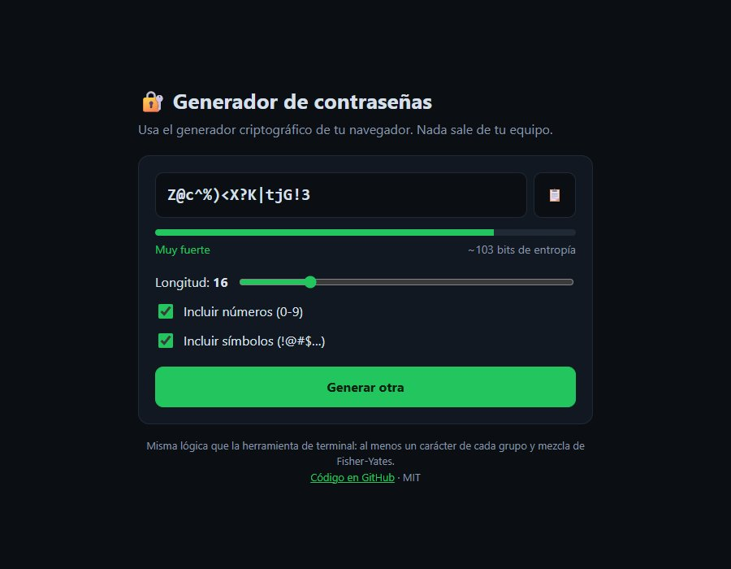

<p align="center"><a href="README.md">Español</a> · <b>English</b></p>

# Secure password generator

**Generates random passwords from the terminal with Node.js's cryptographic generator.**


[](https://virtuanista.github.io/password-generator/)

```text
$ node src/index.js -l 20 -n -s -c 3

Contraseñas generadas:
H)$Sm(!+24rY..qf@zI=
[<)6*<4:bN[td#G8v_FJ
p<w[fz^k!:0.F(e;*MiB

Entropía: ~129 bits (muy fuerte)
```

## Web version

At **[virtuanista.github.io/password-generator](https://virtuanista.github.io/password-generator/)** you have the same logic on a web page: you choose length, numbers and symbols, see the entropy and copy the password with one click. It uses `crypto.getRandomValues` with rejection sampling so there is no bias, and nothing leaves your browser. The code is in [`web/index.html`](web/index.html).



## Features

- Uses `crypto.randomInt`, not `Math.random`, which is predictable and unsuitable for passwords.
- Guarantees at least one letter, plus a number and a symbol if you ask for them.
- Shuffles the result (Fisher-Yates) so those mandatory characters are not always at the beginning.
- Calculates the approximate entropy and tells you whether the password is weak, acceptable, strong or very strong.
- Generates several at once with `--count`.

## Installation

```bash
git clone https://github.com/virtuanista/password-generator.git
cd password-generator
npm install
```

If you want it as a global command: `npm link` and then `password-generator -l 16 -n -s`.

## Usage

| Option | What it does | Default |
|---|---|---|
| `-l, --length <number>` | Password length | 12 |
| `-n, --numbers` | Includes numbers | no |
| `-s, --symbols` | Includes special symbols | no |
| `-c, --count <number>` | How many passwords to generate (1-100) | 1 |
| `-h, --help` | Shows the help | |
| `-V, --version` | Shows the version | |

```bash
node src/index.js              # 12 letters
node src/index.js -l 16 -n     # 16 characters with numbers
node src/index.js -l 24 -n -s  # 24 characters with numbers and symbols
```

## Tests

```bash
npm test
```

Checks the length, that each chosen character group appears, the length errors and the entropy calculation.

## License

[MIT](LICENSE) © 2025 virtuanista

<p align="center">
	Repository made by <a href="https://github.com/virtuanista" target="_blank">virtu 🎣</a>
</p>

<p align="center">
	
</p>

<p align="center">
	Copyright &copy; 2025
</p>

<p align="center">
	<a href="LICENSE"></a>
</p>
