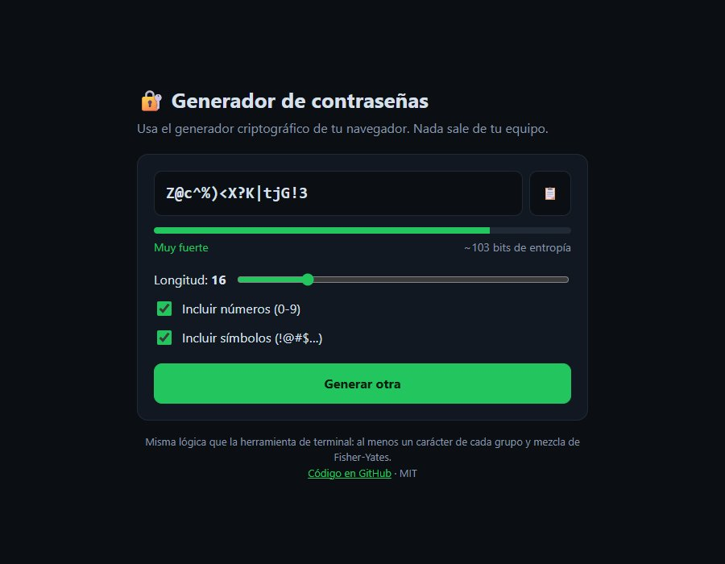

# Generador de contraseñas seguras

**Genera contraseñas aleatorias desde la terminal con el generador criptográfico de Node.js.**


[](https://virtuanista.github.io/password-generator/)

```text
$ node src/index.js -l 20 -n -s -c 3

Contraseñas generadas:
H)$Sm(!+24rY..qf@zI=
[<)6*<4:bN[td#G8v_FJ
p<w[fz^k!:0.F(e;*MiB

Entropía: ~129 bits (muy fuerte)
```

## Versión web

En **[virtuanista.github.io/password-generator](https://virtuanista.github.io/password-generator/)** tienes la misma lógica en una página: eliges longitud, números y símbolos, ves la entropía y la copias con un clic. Usa `crypto.getRandomValues` con muestreo por rechazo para que no haya sesgo, y nada sale de tu navegador. El código está en [`web/index.html`](web/index.html).



## Características

- Usa `crypto.randomInt`, no `Math.random`, que es predecible y no sirve para contraseñas.
- Garantiza al menos una letra, y un número y un símbolo si los pides.
- Mezcla el resultado (Fisher-Yates) para que esos caracteres obligatorios no queden siempre al principio.
- Calcula la entropía aproximada y te dice si la contraseña es débil, aceptable, fuerte o muy fuerte.
- Genera varias de golpe con `--count`.

## Instalación

```bash
git clone https://github.com/virtuanista/password-generator.git
cd password-generator
npm install
```

Si quieres tenerlo como comando global: `npm link` y después `password-generator -l 16 -n -s`.

## Uso

| Opción | Qué hace | Por defecto |
|---|---|---|
| `-l, --length <número>` | Longitud de la contraseña | 12 |
| `-n, --numbers` | Incluye números | no |
| `-s, --symbols` | Incluye símbolos especiales | no |
| `-c, --count <número>` | Cuántas contraseñas generar (1-100) | 1 |
| `-h, --help` | Muestra la ayuda | |
| `-V, --version` | Muestra la versión | |

```bash
node src/index.js              # 12 letras
node src/index.js -l 16 -n     # 16 caracteres con números
node src/index.js -l 24 -n -s  # 24 caracteres con números y símbolos
```

## Pruebas

```bash
npm test
```

Comprueba la longitud, que aparezca cada grupo de caracteres elegido, los errores de longitud y el cálculo de entropía.

## Licencia

[MIT](LICENSE) © 2025 virtuanista

<p align="center">
	Repositorio generado por <a href="https://github.com/virtuanista" target="_blank">virtu 🎣</a>
</p>

<p align="center">
	
</p>

<p align="center">
	Copyright &copy; 2025
</p>

<p align="center">
	<a href="LICENSE"></a>
</p>
